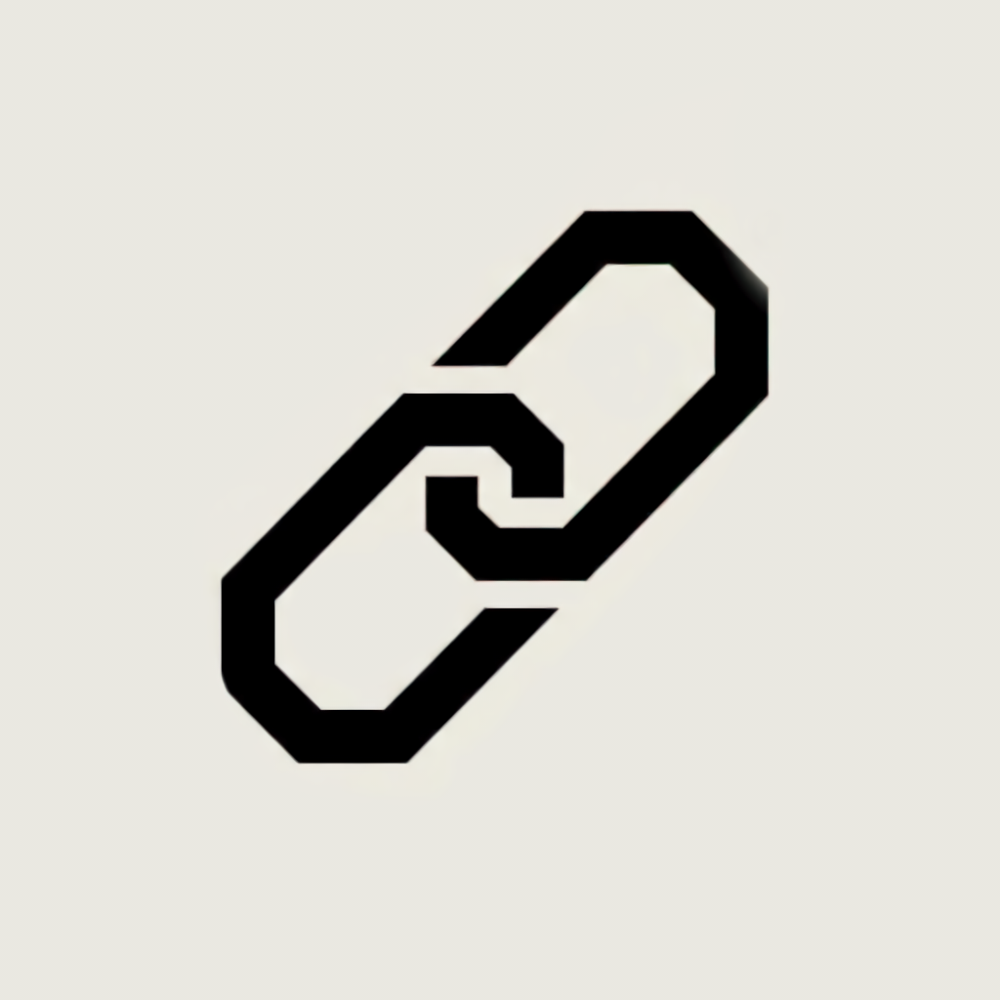

  

  *KeepLink*

**Gestor de enlaces minimalista y privado**

Guardá, organizá y encontrá tus enlaces rápidamente sin intermediarios.  
Sin cuentas, sin anuncios claramente

---

## ✨ Características

### 🔗 Gestión de Enlaces
- **Búsquedas rápidas:** Navegá por *Todos*, *No leídos*, *Leídos* o *Favoritos*
- **Metadatos útiles:** Agregá notas a tus enlaces
- **Vistas previas:** Extracción de imagen en miniatura (opcional)

### 📁 Colecciones
- Organización modular por temas con selector de emojis personalizados.
- Eliminación segura: borrar una colección no borra los enlaces guardados en ella

### 🎨 Personalización
- **Temas integrados:** Modo Sistema, Claro (Blanco), Oscuro, Beige, Morado y Rosa
- **Variedad de lenguajes:** Disponible en Español (`es`), Inglés (`en`), Italiano (`it`), Portugués (`pt`) y Francés (`fr`).

### 📦 Gestión de Datos
- **Exportación e importación:** Copias de seguridad completas en formato **JSON** y **CSV**.

---

## 🔒 Privacidad y Seguridad

KeepLink está diseñada con arquitectura *local-first*:

- **Bloqueo biométrico:** Compatible con huella digital o PIN de 4 dígitos.
- **Cero telemetría:** No recopila estadísticas ni información de uso.
- **Almacenamiento 100% local:** Las bases de datos residen únicamente en tu teléfono.

### Permisos del Sistema

| Permiso | Motivo de uso | Opcional / Desactivable |
| :--- | :--- | :--- |
| `INTERNET` | Descarga de la carátula o miniatura del enlace añadido. | **Sí.** Se puede desactivar por completo desde *Ajustes > Apariencia*. En ese modo, la app opera completamente *offline*. |
| Biometría | Desbloqueo mediante lector de huellas o PIN nativo. | Integrado vía APIs estándar de Android sin almacenar credenciales en la app |

---

## 📲 Instalación

El instalador se distribuye dividido por arquitecturas para reducir el tamaño final en disco:

| Arquitectura | Archivo recomendando | Compatibilidad |
| :--- | :--- | :--- |
| **64-bit (Recomendado)** | `KeepLink-arm64-v8a-release.apk` | La gran mayoría de dispositivos Android modernos. |
| **32-bit (Heredado)** | `KeepLink-armeabi-v7a-release.apk` | Teléfonos antiguos o arquitecturas ARM estándar de 32 bits. |
